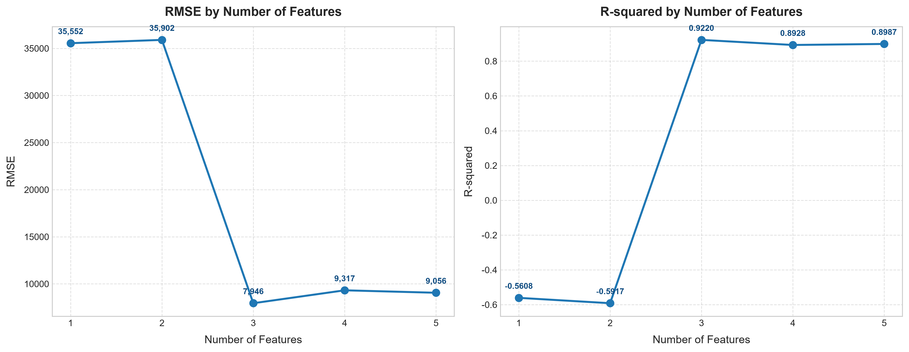
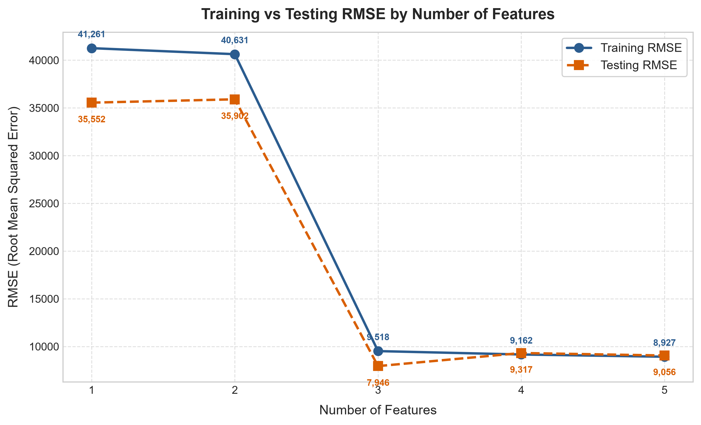

# 50 Startups 多元線性迴歸與特徵選取分析專案 (Multiple Linear Regression & RFE)

[](https://www.python.org/)
[](https://scikit-learn.org/)
[](https://pandas.pydata.org/)
[](LICENSE)

本專案使用 **50 Startups Dataset** 實作完整的機器學習多元線性迴歸（Multiple Linear Regression）與遞迴特徵消除（Recursive Feature Elimination, RFE）流程。專案具備嚴謹的防範資料外洩（Data Leakage Prevention）機制，並提供完整的 CLI 腳本與**現代化互動式 Web 機器學習儀表板**。

---

## 專案目錄結構 (Project Directory)

```text
50-Starup/
├── 50_startups_regression/
│   ├── data/
│   │   └── 50_Startups.csv              # 自動下載的原始資料集 (50 筆紀錄)
│   ├── outputs/
│   │   ├── feature_selection.png        # RMSE 與 R-squared 隨特徵數量變化圖 (左右並排)
│   │   ├── train_test_rmse.png          # 訓練集 vs 測試集 RMSE 比較折線圖 (過擬合診斷)
│   │   └── feature_selection_results.csv# 完整模型評估指標數值表格
│   ├── web/                             # 互動式 Web 分析儀表板 (HTML / CSS / JS)
│   │   ├── index.html                   # 儀表板頁面結構
│   │   ├── style.css                    # 深色玻璃擬物化設計系統 (Vanilla CSS)
│   │   ├── app.js                       # Chart.js 動態繪圖與即時獲利預測計算
│   │   └── data.js                      # 預載模型權重矩陣與資料集 JSON
│   ├── main.py                          # 主分析程式 (自動下載、前處理、RFE、評估、繪圖)
│   ├── serve.py                         # 輕量級本機 Web 伺服器 (http://localhost:8080)
│   ├── requirements.txt                 # Python 依賴清單
│   └── README.md                        # 專案詳細規格文件
├── .gitignore
└── README.md                            # GitHub 首頁展示說明文件
```

---

## 資料集規格 (Dataset Specification)

* **來源網址**：`https://gist.githubusercontent.com/GaneshSparkz/b5662effbdae8746f7f7d8ed70c42b2d/raw/faf8b1a0d58e251f48a647d3881e7a960c3f0925/50_Startups.csv`
* **資料維度**：50 列 (Rows)、5 欄 (Columns)
* **特徵欄位**：
  * `R&D Spend` (數值型)：研發支出（美元）
  * `Administration` (數值型)：行政管理支出（美元）
  * `Marketing Spend` (數值型)：市場行銷支出（美元）
  * `State` (類別型)：公司設立州別（New York, California, Florida）
* **預測目標 (Target)**：
  * `Profit` (數值型)：公司年度獲利（美元）

---

## 資料前處理與特徵工程 (Preprocessing & Methodology)

### 1. 嚴格防範資料外洩 (Data Leakage Prevention)
為了確保模型評估的真實性與學術標準，資料集先經由 80/20 切分（`train_test_split(..., test_size=0.2, random_state=42)`），切分為 **40 筆訓練集** 與 **10 筆測試集**。
> **防護準則**：所有需要學習數據特徵的前處理器（如 `OneHotEncoder`）**一律僅在訓練集上執行 `fit`**，隨後才應用（`transform`）至訓練集與測試集，嚴禁將測試集資訊洩漏進訓練流程。

### 2. One-Hot Encoding 與虛擬變數陷阱 (Dummy Variable Trap)
`State` 欄位包含 3 個相異類別。在多元線性迴歸中，若同時引入 3 個虛擬變數，由於 $D_{\text{CA}} + D_{\text{FL}} + D_{\text{NY}} = 1$，會與迴歸常數項（Intercept）形成完全共線性（Multicollinearity），此即為**虛擬變數陷阱**。
因此採用 `OneHotEncoder(drop='first')`，將 `California` 作為參考基準組（Baseline），展開為 2 個虛擬變數：
- `State_Florida`
- `State_New York`

候選特徵總計 **5 個**：`R&D Spend`、`Administration`、`Marketing Spend`、`State_Florida`、`State_New York`。

---

## 迴歸評估指標定義 (Evaluation Metrics)

* **MSE (均方誤差)**：$\frac{1}{n}\sum_{i=1}^{n}(y_i - \hat{y}_i)^2$，衡量預測值與真實值之平方誤差均值。
* **RMSE (均方根誤差)**：$\sqrt{\text{MSE}}$，單位與利潤相同（美元），數值越小預測越準確。
* **MAE (平均絕對誤差)**：$\frac{1}{n}\sum_{i=1}^{n}|y_i - \hat{y}_i|$，對離群值敏感度較低之平均偏差。
* **R-squared ($R^2$ 判定係數)**：$1 - \frac{\sum (y_i - \hat{y}_i)^2}{\sum (y_i - \bar{y})^2}$，衡量自變數對依變數變異之解釋百分比（越接近 1 擬合度越高）。

---

## 實驗評估結果 (Experimental Results)

透過 `Recursive Feature Elimination (RFE)` 依序測試 1 至 5 個特徵，模型在測試集（Test Set, $N=10$）之實際運算指標如下：

| Number of Features | Selected Features (選入特徵組合) | Train RMSE | Test RMSE | MSE | MAE | R-squared ($R^2$) | 模型狀態 |
| :---: | :--- | :---: | :---: | :---: | :---: | :---: | :---: |
| **1** | `State_New York` | 41,260.98 | **35,552.16** | 1,263,956,018.24 | 24,085.80 | **-0.5608** | 嚴重欠擬合 |
| **2** | `State_Florida`, `State_New York` | 40,631.23 | **35,902.08** | 1,288,959,486.69 | 24,725.66 | **-0.5917** | 嚴重欠擬合 |
| **3** | `R&D Spend`, `State_Florida`, `State_New York` | 9,517.84 | **7,946.37** | 63,144,831.84 | 6,296.78 | **0.9220** | **🏆 最佳模型** |
| **4** | `R&D Spend`, `Administration`, `State_Florida`, `State_New York` | 9,162.34 | **9,316.54** | 86,797,850.66 | 7,436.62 | **0.8928** | 微幅過擬合 |
| **5** | 全 5 項特徵 (`+ Marketing Spend`) | 8,927.49 | **9,055.96** | 82,010,363.04 | 6,961.48 | **0.8987** | 微幅過擬合 |

---

## 視覺化成果 (Visualizations)

### 1. 特徵數量對 RMSE 與 R-squared 之影響 (左右並排)


### 2. 訓練集 vs. 測試集 RMSE（過擬合與欠擬合診斷）


---

## 過擬合與欠擬合深度分析 (Overfitting & Underfitting Analysis)

1. **嚴重欠擬合階段 ($k = 1, 2$)**：
   - 特徵組合僅有州別虛擬變數，完全缺少最核心的研發支出（`R&D Spend`）。
   - 訓練集與測試集 RMSE 均高達 35,000 ~ 41,000 美元以上，且測試集 $R^2$ 為負值（$-0.56 \sim -0.59$）。
   - 此時模型屬於**高偏差 (High Bias)**，完全無泛化預測能力。
2. **最佳泛化平衡點 ($k = 3$)**：
   - 納入關鍵特徵 `R&D Spend` 後，測試集 RMSE 驟降至 **$7,946.37**（全實驗最低），$R^2$ 達 **0.9220**（全實驗最高）。
   - 說明研發支出是預測創業公司獲利最顯著且穩健的驅動變數。
3. **微幅過擬合階段 ($k = 4, 5$)**：
   - 當陸續加入 `Administration` 與 `Marketing Spend` 時，**訓練集 RMSE 持續單調遞減**（9,517 $\rightarrow$ 9,162 $\rightarrow$ 8,927），代表模型在已知資料上擬合得更貼切；
   - 然而，**測試集 RMSE 卻反彈至 9,055 ~ 9,316**，且 $R^2$ 微幅下滑至 0.8987。
   - 訓練誤差下降但泛化誤差上升的背離現象，清楚體現了模型因引入較多非關鍵參數而產生之**微幅過擬合 (Slight Overfitting)**。

---

## 快速開始 (Quick Start)

### 1. 安裝環境與套件
```bash
git clone https://github.com/Augustine-723/50-Starup.git
cd 50-Starup/50_startups_regression
pip install -r requirements.txt
```

### 2. 執行機器學習分析管線
```bash
python main.py
```
> 一鍵自動下載資料集、執行前處理、RFE 特徵選取、計算評估指標並輸出圖表至 `outputs/` 目錄。

### 3. 啟動互動式 Web 儀表板
```bash
python serve.py
```
開啟瀏覽器訪問 **`http://localhost:8080`**，即可使用：
* 📊 **動態圖表與評估表格**
* 🔍 **RFE 迴歸方程式動態產生器**
* 🧮 **即時獲利預測器 (可拖拉數值拉桿即時試算)**
* 📈 **過擬合/欠擬合互動式診斷圖**
* 📋 **50 Startups 資料集即時搜尋過濾器**
