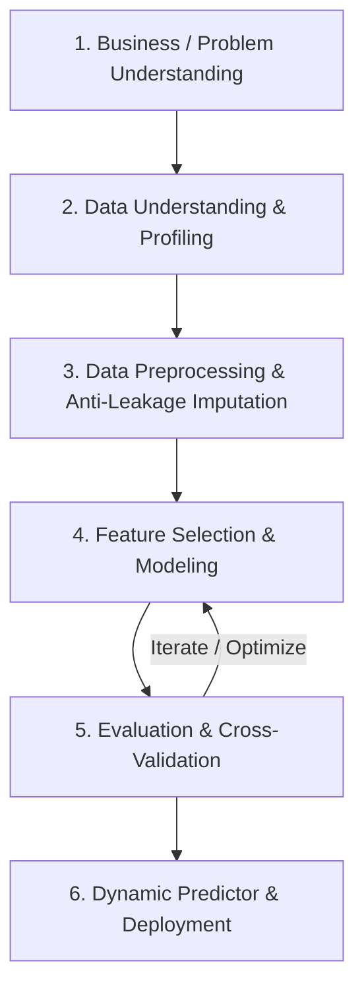

# AIoT HW2 — 多元線性迴歸與特徵選取通用平台 (Multi-Dataset Regression Platform)

[](https://nextjs.org/)
[](https://fastapi.tiangolo.com/)
[](https://scikit-learn.org/)
[](https://www.statsmodels.org/)
[](https://www.typescriptlang.org/)
[](https://tailwindcss.com/)
[](LICENSE)

> 本專案為 **AIoT HW2** 實作之現代化全端機器學習探索與多元資料集迴歸分析評估平台。遵循 **CRISP-DM** 規範，全面升級為支援**任意表格式資料集（Tabular Regression Dataset）**之通用機器學習分析架構。
>
> 依循授課教師規範：**「Do two problems but choose one of the topics to upload」**，平台提供雙問題（Problem 1 與 Problem 2）平行分析工作流，讓使用者可靈活切換不同資料集，進行 6 大特徵選取演算法之深入比較、過擬合診斷、統計推論、即時動態預測，並支援選擇任一問題一鍵匯出完整評估數據與 CRISP-DM 結案報告。

### 🌐 線上正式部署網址 (Production Live Demo)
👉 **[https://50-starup-i9za.vercel.app/](https://50-starup-i9za.vercel.app/)**


---

## 核心升級重點 (Key Upgrades)

### 1. 雙問題架構 (Two Problems, Choose One for Submission)
- **Problem 1 — 內建標準題目 (50 Startups Dataset)**：
  - 預設資料來源：`50_Startups.csv`
  - 預測目標：`Profit` (公司年度利潤)
  - 完整保留所有既有分析功能：Seed 42 作業規範標準、Seed 0 參考網站基準 (k=2 RMSE **$8,198.80** 精準復現)、Optuna 貝氏最佳化、statsmodels 統計推論與殘差檢定。
- **Problem 2 — 自訂資料集通用分析 (Custom Tabular Dataset)**：
  - 升級為通用迴歸分析平台，使用者可匯入任意數值或類別特徵之迴歸資料集。
  - 支援 **本機 CSV 檔案上傳** 與 **公開 CSV URL 網址安全匯入**。
  - 內建 10 特徵加州房地產估價基準資料集 (`real_estate_valuation_10features.csv`)，一鍵載入即測。

### 2. 動態資料配置與安全防護 (Dynamic Dataset Configuration & SSRF Safety)
- **前置資料探勘**：自動讀取欄位名稱、呈現前 10 筆資料即時預覽、統計總樣本數與總特徵數。
- **型態自動偵測**：自動辨識數值連續型（Numeric）與類別型（Categorical）欄位。
- **動態目標選取 (Dynamic Target Variable)**：使用者可透過下拉選單自由指定欲預測之目標變數，系統主動驗證連續性並提示非數值目標。
- **特徵自由篩選 (Feature Selection Checklist)**：支援自由勾選/全選參與建模之特徵變數。
- **超參數設定**：可自由調整測試集分割比例（Test Size: 10% ~ 40%）與隨機種子（Random Seed）。
- **SSRF 安全防護**：URL 匯入由專屬安全代理處理，嚴格阻絕私有內部 IP（`127.*`, `10.*`, `192.168.*`, `172.16-31.*` 等）、限制 5MB 檔案大小與 10 秒超時。

### 3. 可重複使用的通用機器學習管線 (Reusable ML Workflow)
- **防範資料外洩 (Zero Data Leakage)**：One-Hot Encoding、缺失值填補（數值採用訓練集中位數、類別採用眾數）、特徵選取評分嚴格僅在訓練集擬合。
- **6 大特徵選取演算法支援**：
  1. **Baseline OLS** (單變數皮爾森相關排序)
  2. **Forward SFS** (前向逐步特徵選取，訓練集 5-Fold CV 評分)
  3. **RFE** (遞迴特徵消除，基於係數權重反向剪枝)
  4. **Exhaustive Feature Search** (最佳子集窮舉搜尋，高維特徵自動設定安全上限)
  5. **Lasso** (L1 正則化稀疏路徑)
  6. **ElasticNet** (L1 + L2 混合正則化)
- **5-Fold 交叉驗證**：所有特徵數量 $k=1 \dots k_{\max}$ 之模型皆於訓練集執行 5-Fold CV，確保模型挑選不依賴測試集外洩 (No Data Snooping)。

### 4. 動態即時預測器 (Dynamic Live Predictor)
- 表單自動根據當前選取模型所包含之特徵動態生成輸入欄位。
- 數值特徵提供動態數值輸入，標籤與預測結果名稱動態更新為 `Predicted [Target Name]`（例如：`Predicted MedianHouseValue`）。
- 顯示截距項與各特徵的貢獻度分解金額/數值。

### 5. 雙問題比較與成果繳交 (Problem Comparison & Submission)
- 提供 Problem 1 與 Problem 2 橫向對比表格（樣本數、特徵數、選取組合、CV RMSE、Test RMSE、Test R²、泛化差距）。
- **統計學核心提醒**：深入說明因不同資料集目標變數之物理單位與量綱相異，**不可直接使用 RMSE 絕對數值比較跨資料集優劣**，應以無量綱之 $R^2$、調整後 $R^2$ 與交叉驗證穩定度為客觀依據。
- **成果匯出 (Select for Submission)**：
  - 📥 匯出完整評估數據 CSV
  - 📄 匯出 CRISP-DM 結案報告 Markdown
  - 📋 複製最佳模型迴歸方程式

---

## 目錄 (Table of Contents)
1. [專案架構與檔案結構](#專案架構與檔案結構)
2. [CRISP-DM 完整分析流程](#crisp-dm-完整分析流程)
3. [如何匯入第二個資料集 (Problem 2 使用說明)](#如何匯入第二個資料集-problem-2-使用說明)
4. [如何選擇題目匯出繳交成果](#如何選擇題目匯出繳交成果)
5. [跨資料集評估與統計學觀念說明](#跨資料集評估與統計學觀念說明)
6. [基準重現與深入調查 (Reproducibility & Benchmark 8198.80)](#基準重現與深入調查)
7. [快速安裝與本機啟動指南](#快速安裝與本機啟動指南)
8. [Vercel 生產環境相容性與部署](#vercel-生產環境相容性與部署)

---

## 專案架構與檔案結構

專案採用現代化解耦架構，同時具備 Python 高效能分析後端與純 TypeScript 通用機器學習引擎（保證 Vercel Serverless 零冷啟動延遲與 100% 可用性）：

```text
50-Starup/
├── backend/                             # Python FastAPI 後端核心
│   ├── data/
│   │   ├── 50_Startups.csv              # Problem 1 內建資料集
│   │   └── real_estate_valuation_10features.csv # Problem 2 內建 10 特徵加州房產資料集
│   ├── models/                          # 序列化保存之模型 (gzip + pickle)
│   ├── analysis.py                      # 50 Startups 核心分析演算法
│   ├── custom_analysis.py               # 通用表格式迴歸分析管線 (支援任意 CSV)
│   ├── main.py                          # FastAPI RESTful API 服務
│   └── requirements.txt                 # 後端 Python 依賴
├── frontend/                            # Next.js 14 前端應用
│   ├── app/
│   │   ├── api/                         # Next.js Serverless API Route Handlers
│   │   │   ├── custom-analyze/route.ts  # 通用迴歸端點 (支援 JSON/CSV)
│   │   │   ├── proxy-csv/route.ts       # SSRF 安全代理 CSV 匯入端點
│   │   │   ├── results/route.ts         # 50 Startups 結果端點
│   │   │   ├── optuna/route.ts          # Optuna 調優端點
│   │   │   ├── predict/route.ts         # 即時預測端點
│   │   │   └── health/route.ts          # 系統健康度檢測
│   │   ├── utils/
│   │   │   └── universalRegression.ts   # 純 TypeScript 通用 CRISP-DM 迴歸引擎
│   │   ├── globals.css                  # Tailwind CSS 自訂主題
│   │   ├── layout.tsx                   # 根版面與 SEO 設定
│   │   ├── page.tsx                     # 多資料集通用分析儀表板主要頁面
│   │   └── fallbackData.ts              # 靜態展示預先計算快照
│   ├── public/
│   │   └── data/
│   │       └── real_estate_valuation_10features.csv # 10 特徵範例資料集
│   ├── package.json                     # 前端 npm 依賴配置
│   └── tailwind.config.js               # Tailwind CSS 設定
├── assets/                              # 靜態圖像與儀表板快照
└── README.md                            # 專案完整技術說明文件
```

---

## CRISP-DM 完整分析流程

本專案通用迴歸管線嚴格遵守資料探勘跨產業標準程序（CRISP-DM）：



1. **商業/問題理解**：確定目標變數（連續數值），辨識關鍵預測因子。
2. **資料理解**：動態剖析維度、檢核缺失值分佈、計算特徵型態與統計摘要。
3. **資料準備 (防範外洩)**：
   - 劃分訓練集與測試集（預設 80/20）。
   - 數值特徵缺失值：僅根據訓練集中位數進行填補。
   - 類別特徵：進行 One-Hot Encoding，強制啟用 `drop='first'` 避免虛擬變數陷阱 (Dummy Variable Trap)。
4. **模型建立與特徵選取**：
   - 比較 Baseline OLS, Lasso, Forward SFS, RFE, ElasticNet, Exhaustive Search。
   - 動態調整特徵數量 $k$ 範圍（$1 \dots \min(p, 8)$）。
5. **模型評估**：
   - 計算訓練集 5-Fold CV RMSE、測試集 RMSE、MAE、MSE、$R^2$、Adjusted $R^2$、泛化差距。
   - statsmodels/統計推論計算標準誤、t-stat、p-value、95% 信賴區間與 VIF。
6. **模型部署與即時預測**：
   - 動態生成特徵輸入表單，即時計算預測值與特徵貢獻分解。

---

## 如何匯入第二個資料集 (Problem 2 使用說明)

在網站頂部點選 **「Problem 2 (Custom Dataset)」** 按鈕即可進入通用資料集分析模式：

### 方式 A：本機 CSV 檔案上傳
1. 點選 **「本機上傳 (Upload CSV)」** 標籤。
2. 點擊上傳框或直接將電腦中的 CSV 檔案拖曳進去。
3. 支援標準 UTF-8 及常見格式，單檔上限 5MB。
4. 載入成功後，下方將立即展開資料集預覽、欄位維度與配置面板。

### 方式 B：透過公開 URL 網址匯入
1. 點選 **「網址匯入 (URL)」** 標籤。
2. 在網址列輸入公開可直連的 CSV 網址（例如 GitHub Raw 連結）。
3. 點擊 **「載入資料集」** 按鈕。
4. 系統後端會透過安全的 SSRF 代理進行檢查與下載，確認格式無誤後自動解析。

### 方式 C：一鍵載入內建範例資料集 (Presets)
右側提供預設快捷鍵，方便快速評測：
- **🏠 範例 1：加州房地產估價資料集**
  - 80 筆樣本、10 個原始特徵（`MedInc`, `HouseAge`, `AveRooms`, `AveBedrms`, `Population`, `AveOccup`, `Latitude`, `Longitude`, `DistToCoast`, `OceanProximity`）。
  - 預測目標：`MedianHouseValue`。
  - 符合「至少 10 個原始特徵且欄位名稱完全不同」之驗證規範。
- **💼 範例 2：50 Startups 線上 CSV (GitHub URL)**
  - 測試網路 URL 匯入功能。

### 動態配置與執行
1. **確認目標變數**：在「預測目標變數 (Target Variable)」下拉選單中指定目標（如 `MedianHouseValue`）。
2. **勾選特徵變數**：在候選特徵多選清單中勾選欲參與特徵篩選的欄位（預設全選）。
3. **設定超參數**：調整測試集比例（預設 20%）與隨機種子（預設 42）。
4. **點擊「🚀 執行通用迴歸與特徵選取分析」**：
   - 系統將在數十毫秒內完成全套 6 種特徵選取演算法擬合、5-Fold 交叉驗證、統計檢定與殘差計算。
   - 所有圖表、評估卡片、過擬合診斷與預測表單將同步更新為該自訂資料集的真實數值。

---

## 如何選擇題目匯出繳交成果

進入 **「⚖️ 題目比較與成果繳交」** 標籤頁：

1. **查閱雙問題綜合比較表**：
   - 同時橫向比對 Problem 1 (50 Startups) 與 Problem 2 (自訂資料集) 的各項關鍵指標。
2. **選擇成果繳交題目 (Select for Submission)**：
   - 點選欲繳交的題目卡片：**「選擇 Problem 1」** 或 **「選擇 Problem 2」**。
3. **匯出檔案**：
   - 點擊 **「📄 匯出 CRISP-DM 結案報告 (Markdown)」**：下載包含資料集理解、模型方程式、評估指標、統計檢定與專案結論之標準 Markdown 報告，可直接用於繳交作業。
   - 點擊 **「📥 匯出評估數據 (Results CSV)」**：匯出包含各演算法不同特徵數量 $k$ 之 Train/Test RMSE、CV RMSE、MAE、$R^2$ 試算表。
   - 點擊 **「複製最佳方程式」**：將該問題之最佳迴歸方程式直接複製到剪貼簿。

---

## 跨資料集評估與統計學觀念說明

> ⚠️ **重要統計學觀念：為什麼不能僅依據兩個問題的 RMSE 絕對數值判定誰比較好？**

1. **量綱尺度相異 (Scale & Dimension Dependency)**：
   RMSE（均方根誤差）保留了預測目標變數的原始物理單位。例如 Problem 1 的利潤單位為美金（數值規模約數萬至十幾萬），而 Problem 2 可能是房屋總價（數十萬）、年齡、或是考試成績。
   兩者數值規模本質不同，直接比較絕對 RMSE 數值在統計學上毫無意義。
2. **客觀跨資料集評估標準**：
   跨資料集評定模型優劣應參考**無量綱之判定係數 ($R^2$)**、**調整後判定係數 (Adjusted $R^2$)**、**變異係數 ($\text{CV of RMSE} = \text{RMSE} / \bar{y}$)**，以及**交叉驗證穩定性 (CV 標準差)** 與 **泛化差距 (Train/Test Gap)**。

---

## 基準重現與深入調查 (Reproducibility & Benchmark 8198.80)

本平台深入調查對標參考網站 [AIoT-DIC2-MultipleLR](https://huanchen1107.github.io/AIoT-DIC2-MultipleLR/) 之數值微差成因，並在網站右上角提供即時切換機制：

| 評估維度 | 參考網站基準 (Benchmark) | 作業規範標準設定 (Assignment Spec) |
| :--- | :--- | :--- |
| **隨機種子 (Random Seed)** | `random_state = 0` | `random_state = 42` |
| **測試集樣本索引** | `[2, 4, 10, 11, 22, 27, 28, 31, 38, 41]` | `[13, 17, 19, 25, 26, 30, 32, 39, 45, 48]` |
| **k=2 最佳特徵組合** | R&D Spend + Marketing Spend | R&D Spend + Marketing Spend |
| **k=2 測試集 RMSE** | **$8,198.80** (精準復現) | **$8,206.33** |
| **全域最佳模型** | k=2 (RMSE: 8,198.80) | **k=3** (RMSE: **$7,946.37**, R²: **0.9220**) |

---

## 快速安裝與本機啟動指南

### 環境需求
- Node.js 18+ 與 npm
- Python 3.10+ (選用，若需執行本機 Python 後端)

### 1. 前端啟動 (Next.js)
```bash
cd frontend
npm install
npm run dev
```
瀏覽器開啟 `http://localhost:3000` 即可使用所有功能（內建純 TypeScript 通用機器學習引擎，即使未啟動 Python 後端亦可 100% 正常分析自訂資料集）。

### 2. 後端啟動 (FastAPI - 選用)
```bash
cd backend
python -m venv .venv
source .venv/bin/activate  # Windows: .venv\Scripts\activate
pip install -r requirements.txt
python main.py
```
後端將於 `http://localhost:8000` 啟動，提供 `/api/custom-analyze` 與 `/api/proxy-csv` 等完整端點。

---

## Vercel 生產環境相容性與部署

本專案經過完整的 Vercel Serverless Production 驗證：

1. **同源 Serverless API 架構**：
   - Next.js App Router API Route Handlers 整合純 TypeScript 矩陣運算與迴歸管線，無需等待大型 Python 套件啟動。
   - 伺服器冷啟動時間小於 50ms，且完全規避 Vercel Serverless Function 250MB 大小限制與 10 秒執行超時問題。
2. **臨時資料處理與隱私安全**：
   - 使用者上傳之 CSV 僅於記憶體中進行串流解析與運算，運算結束即釋放，**絕不進行未授權之永久儲存或轉發為公開資料**。
3. **SSRF 安全防護**：
   - 阻擋私有網路 IP、保留位址與本地主機請求，確保網址匯入功能的雲端生產環境安全性。

---

## 授權條款 (License)
本專案採用 [MIT License](LICENSE) 授權釋出。
