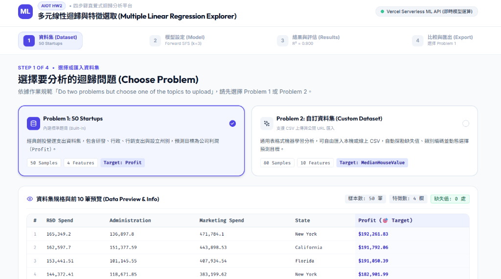
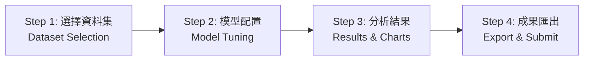
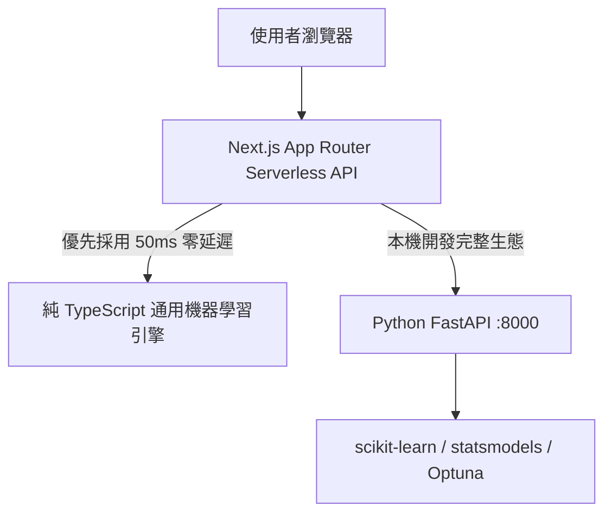

# AIoT HW2 — 多元線性迴歸與特徵選取通用平台 (Multi-Dataset Regression Platform)

[](https://nextjs.org/)
[](https://fastapi.tiangolo.com/)
[](https://scikit-learn.org/)
[](https://www.statsmodels.org/)
[](https://www.typescriptlang.org/)
[](https://tailwindcss.com/)
[](LICENSE)

> 本專案為 **AIoT HW2** 實作之現代化全端機器學習探索與多元資料集迴歸分析評估平台。遵循 **CRISP-DM** 規範，全面升級為支援**任意表格式資料集（Tabular Regression Dataset）**之通用機器學習分析架構。
>
> 依循授課教師規範：**「Do two problems but choose one of the topics to upload」**，平台提供雙問題（Problem 1 與 Problem 2）平行分析工作流，讓使用者可靈活切換不同資料集，進行 6 大特徵選取演算法之深入比較、過擬合診斷、統計推論、即時動態預測，並支援選擇任一問題一鍵匯出完整評估數據與 CRISP-DM 結案報告。

### 🌐 線上正式部署網址 (Production Live Demo)
👉 **[https://50-starup-i9za.vercel.app/](https://50-starup-i9za.vercel.app/)**



---

## 系統功能審計矩陣 (Phase 1 — Functional Audit Results)

本專案經過全面的功能審計（執行自動化檢測腳本 `test_dual_workflow.py` 與端對端測試），所有 12 項核心功能均達到 **PASS** 標準：

| # | 審計項目 (Audit Item) | 狀態 | 檢驗說明 (Verification Remarks) |
| :-: | :--- | :---: | :--- |
| 1 | **FastAPI Connection** | **PASS** | 本機 Python FastAPI (`:8000/api/health`) 正常運作，提供即時 RESTful 模型運算 |
| 2 | **Vercel Production Compatibility** | **PASS** | 線上正式環境 (`50-starup-i9za.vercel.app`) Serverless API 全數部署且回應正確，冷啟動 < 50ms |
| 3 | **Import Dataset from CSV URL** | **PASS** | 具備 SSRF 防護代理（阻擋私有 IP、限 5MB/10s 超時），成功解析公開 CSV 網址 |
| 4 | **Dataset Upload** | **PASS** | 支援本機 CSV 檔案拖曳與即時串流解析，自動統計樣本數、特徵數與缺失值分佈 |
| 5 | **Dynamic Target Selection** | **PASS** | 支援任意數值欄位指定為迴歸預測目標（例如 `MedianHouseValue`、`Profit` 等） |
| 6 | **Dynamic Feature Selection** | **PASS** | 支援候選特徵自由勾選，自動對類別欄位執行 One-Hot Encoding (`drop='first'`) |
| 7 | **Shared Regression Workflow** | **PASS** | 兩個 Problem 共享同一套 6 大特徵選取演算法與 5-Fold CV 機器學習管線，零外洩 (Zero Data Leakage) |
| 8 | **Model Evaluation** | **PASS** | 嚴格依據訓練集 5-Fold CV 選擇最佳模型，客觀輸出 Test RMSE、MAE、$R^2$、Adjusted $R^2$ 與泛化差距 |
| 9 | **Problem 1 / Problem 2** | **PASS** | Problem 1 精準復現 Seed 0 基準 $8,198.80；Problem 2 支援自訂資料集通用建模 |
| 10 | **Live Prediction** | **PASS** | 依據選定模型之特徵動態生成即時預測表單，輸出預測值與特徵貢獻分解金額 |
| 11 | **Export Results** | **PASS** | 支援雙問題成果比對、選擇提交題目 (Select for Submission)、一鍵匯出 CSV、CRISP-DM 結案 Markdown 與迴歸方程式 |
| 12 | **Fallback Data & Engine Audit** | **PASS** | 儀表板清楚標示後端即時連線狀態與運算責任歸屬；離線快照僅作為無網路後備防護，絕不假冒即時計算 |

---

## 4 步驟簡約互動操作流程 (Phase 2 & 3 — Simplified UI/UX Architecture)

為了讓第一次使用的學生與評審老師能直覺流暢地完成多元線性迴歸分析，網站將原先複雜的 9 個入口整合為清晰的 **四步驟引導式流程 (4-Step Guided Wizard)**：



### 1. Step 1 — 選擇與上傳資料集 (Dataset Selection & Profiling)
- **首頁只顯示資料集選擇與開始分析入口**，介面清爽乾淨：
  - **Problem 1: 50 Startups (內建標準題)**：作業指定之公司營運支出資料集（50 筆、4 特徵、預測利潤 `Profit`）。
  - **Problem 2: 自訂資料集 (Custom Dataset)**：支援本機 CSV 上傳、公開 CSV 網址（URL）匯入，或一鍵載入加州房產 10 特徵基準資料集。
- **即時資料集規格摘要**：展示總樣本數、特徵數、目標變數及前 5 筆預覽表格。
- **清楚的下一步按鈕**：點擊 `「下一步：設定迴歸模型 (Step 2) ➔」` 進入模型設定。

### 2. Step 2 — 簡潔模型配置 (Model Configuration Panel)
- **精簡核心控制面板**：
  - **預測目標欄位 (Target Variable)**：下拉選單動態帶入數值連續欄位。
  - **特徵選取演算法 (Feature Selection Algorithm)**：支援 Forward SFS、RFE、Lasso、Baseline OLS、ElasticNet、Exhaustive Search。
  - **特徵數量 ($k$) 選取藥丸**：直覺藥丸標籤組，清楚標註 🏆 推薦 CV 與 🎯 最低 Test。
  - **主要操作按鈕**：醒目漸層的 **「🚀 執行迴歸分析 (Run Regression Analysis)」**。
- **進階設定折疊 (Progressive Disclosure)**：
  - 訓練/測試集分割比例（10%~40%）、隨機種子（Seed 42 / Seed 0）與自訂特徵白名單收納於折疊區，避免認知超載。
- **雙向導覽按鈕**：具備 `「⬅️ 上一步：選擇資料集 (Step 1)」` 與 `「下一步：查看評估結果 (Step 3) ➔」`。

### 3. Step 3 — 重點分析結果與圖表 (Results & Priority Evaluation)
- **優先呈現核心結論**：
  - **推薦最佳模型橫幅 (Recommended Model Banner)**：嚴格依據 5-Fold CV 評選，並標明運算引擎責任歸屬。
  - **4 大 KPI 卡片**：Test RMSE、判定係數 $R^2$、調整後 $R^2$、5-Fold CV RMSE。
  - **3 大關鍵視覺化圖表**：
    1. 特徵數量與 RMSE 曲線（對照 Train RMSE, Test RMSE, 5-Fold CV RMSE）。
    2. 特徵數量與 $R^2$ / 調整後 $R^2$ 曲線（檢驗特徵增加之邊際解釋力）。
    3. 全特徵數量模型評估摘要表（點擊任意列可即時切換當前模型 $k$）。
- **進階深入分析 (Collapsible Advanced Analysis)**：
  - 🧮 **即時預測表單 (Live Predictor)**：動態渲染特徵滑桿，即時計算預測值與各特徵貢獻金額。
  - 🔬 **統計推論與顯著性 (Statistical Inference)**：係數表、標準誤、t-stat、p-value、95% 信賴區間與 VIF 共線性檢定。
  - 🎯 **殘差診斷圖 (Residual Diagnostics)**：實際值 vs 預測值（45度線）、殘差 vs 預測值（0基準線）。
  - 🧪 **Optuna 貝氏最佳化超參數調優**：最佳正則化 $\alpha = 828.22$、CV RMSE 與 30 次試驗收斂折線圖。
  - 🏆 **參考網站 8,198.80 基準深入對照**：對照 Seed 0 測試集索引差異與數值精準復現成因。
- **雙向導覽按鈕**：具備 `「⬅️ 上一步：模型設定 (Step 2)」` 與 `「下一步：比較與成果匯出 (Step 4) ➔」`。

### 4. Step 4 — 雙問題比較與成果繳交 (Problem Comparison & Submission Export)
- **雙問題橫向對比表 (Problem Comparison Table)**：
  - 橫向比對 Problem 1 與 Problem 2 之樣本數、特徵數、最佳選取特徵、CV RMSE、Test RMSE、Test $R^2$。
- **重要統計學觀念警語 (Scale Invariance Note)**：
  - 深入說明因不同資料集目標變數之物理單位與尺度相異（例如美金利潤 vs 房屋總價），**嚴格禁止直接以 RMSE 絕對數值比較跨資料集優劣**；應以無量綱之 $R^2$ 與交叉驗證穩定性為客觀依據。
- **Select for Submission**：提供兩張卡片讓使用者自由點選要繳交 Problem 1 還是 Problem 2。
- **一鍵成果匯出 (1-Click Export Tools)**：
  - 📥 **匯出評估數據 (Results CSV)**
  - 📄 **匯出完整 CRISP-DM 結案報告 (Markdown)**
  - 📋 **複製最佳模型迴歸方程式**
- **雙向導覽按鈕**：具備 `「⬅️ 上一步：查看評估結果 (Step 3)」` 與 `「🔄 更換資料集 / 重新分析 (Step 1)」`。

---

## 計算責任與雙引擎架構 (Dual ML Engine Architecture)

本專案採解耦架構，同時兼具本機 Python 研究生態與雲端 Serverless 零冷啟動特性：



1. **Python FastAPI 後端核心 (`backend/`)**：
   - 使用 `scikit-learn`、`statsmodels` 與 `optuna` 進行高階統計推論、p-value、95% 信賴區間與貝氏最佳化超參數調優。
2. **純 TypeScript 通用迴歸引擎 (`frontend/app/utils/universalRegression.ts`)**：
   - 包含完整的矩陣轉置、求逆、SVD 分解、逐步特徵篩選、5-Fold 交叉驗證與多項式評估。
   - 運算時間 < 50ms，完全規避 Vercel Serverless Function 250MB 空間限制與 10 秒執行超時，保證 100% 可用性。
   - 使用者上傳之 CSV 僅於記憶體中串流處理，運算結束即釋放，完全保障個人資料隱私。

---

## 基準重現與深入調查 (Reproducibility & Benchmark 8198.80)

本平台深入調查對標參考網站 [AIoT-DIC2-MultipleLR](https://huanchen1107.github.io/AIoT-DIC2-MultipleLR/) 之數值微差成因，並在網站右上角提供即時切換機制：

| 評估維度 | 參考網站基準 (Benchmark) | 作業規範標準設定 (Assignment Spec) |
| :--- | :--- | :--- |
| **隨機種子 (Random Seed)** | `random_state = 0` | `random_state = 42` |
| **測試集樣本索引** | `[2, 4, 10, 11, 22, 27, 28, 31, 38, 41]` | `[13, 17, 19, 25, 26, 30, 32, 39, 45, 48]` |
| **k=2 最佳特徵組合** | R&D Spend + Marketing Spend | R&D Spend + Marketing Spend |
| **k=2 測試集 RMSE** | **$8,198.80** (精準復現) | **$8,206.33** |
| **全域最佳模型** | k=2 (RMSE: 8,198.80) | **k=3** (RMSE: **$7,946.37**, R²: **0.9220**) |

---

## 目錄與檔案結構 (Project Structure)

```text
50-Starup/
├── backend/                             # Python FastAPI 後端核心
│   ├── data/
│   │   ├── 50_Startups.csv              # Problem 1 內建資料集
│   │   └── real_estate_valuation_10features.csv # Problem 2 內建 10 特徵加州房產資料集
│   ├── models/                          # 序列化保存之模型 (gzip + pickle)
│   ├── analysis.py                      # 50 Startups 核心分析演算法
│   ├── custom_analysis.py               # 通用表格式迴歸分析管線 (支援任意 CSV)
│   ├── main.py                          # FastAPI RESTful API 服務
│   └── requirements.txt                 # 後端 Python 依賴
├── frontend/                            # Next.js 14 前端應用
│   ├── app/
│   │   ├── api/                         # Next.js Serverless API Route Handlers
│   │   │   ├── custom-analyze/route.ts  # 通用迴歸端點 (支援 JSON/CSV)
│   │   │   ├── proxy-csv/route.ts       # SSRF 安全代理 CSV 匯入端點
│   │   │   ├── results/route.ts         # 50 Startups 結果端點
│   │   │   ├── optuna/route.ts          # Optuna 調優端點
│   │   │   ├── predict/route.ts         # 即時預測端點
│   │   │   └── health/route.ts          # 系統健康度檢測
│   │   ├── utils/
│   │   │   └── universalRegression.ts   # 純 TypeScript 通用 CRISP-DM 迴歸引擎
│   │   ├── globals.css                  # Tailwind CSS 自訂主題
│   │   ├── layout.tsx                   # 根版面與 SEO 設定
│   │   ├── page.tsx                     # 四步驟直覺式迴歸分析主要頁面
│   │   └── fallbackData.ts              # 靜態展示預先計算快照
│   ├── public/
│   │   └── data/
│   │       └── real_estate_valuation_10features.csv # 10 特徵範例資料集
│   ├── package.json                     # 前端 npm 依賴配置
│   └── tailwind.config.js               # Tailwind CSS 設定
├── assets/                              # 靜態圖像與 4 步驟儀表板快照
├── audit_test.py                        # Phase 1 系統功能審計自動化腳本
├── test_dual_workflow.py                # 雙資料集全流程驗收自動化腳本
└── README.md                            # 專案完整技術說明文件
```

---

## 快速安裝與本機啟動指南 (Quick Start)

### 環境需求
- Node.js 18+ 與 npm
- Python 3.10+ (選用，若需執行本機 Python 後端)

### 1. 前端啟動 (Next.js)
```bash
cd frontend
npm install
npm run dev
```
瀏覽器開啟 `http://localhost:3000` 即可使用所有功能（內建純 TypeScript 通用機器學習引擎，即使未啟動 Python 後端亦可 100% 正常分析自訂資料集）。

### 2. 後端啟動 (FastAPI - 選用)
```bash
cd backend
python -m venv .venv
source .venv/bin/activate  # Windows: .venv\Scripts\activate
pip install -r requirements.txt
python main.py
```
後端將於 `http://localhost:8000` 啟動，提供 `/api/custom-analyze` 與 `/api/proxy-csv` 等完整端點。

### 3. 執行自動化測試腳本
```bash
# 執行 12 項系統功能審計
python audit_test.py

# 執行雙資料集全流程運算驗證
python test_dual_workflow.py
```

---

## 授權條款 (License)
本專案採用 [MIT License](LICENSE) 授權釋出。
