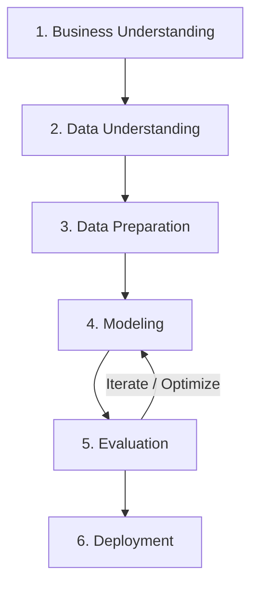

# AIoT HW2 — 50 Startups Multiple Linear Regression Explorer

[](https://nextjs.org/)
[](https://fastapi.tiangolo.com/)
[](https://scikit-learn.org/)
[](https://www.statsmodels.org/)
[](https://optuna.org/)
[](https://tailwindcss.com/)
[](LICENSE)

> 本專案為 **AIoT HW2** 實作之現代化全端機器學習探索與評估系統（Full-Stack Machine Learning Explorer）。參考 [AIoT-DIC2-MultipleLR 儀表板](https://huanchen1107.github.io/AIoT-DIC2-MultipleLR/) 的資訊架構與視覺理念，以 **CRISP-DM** 規範為基礎，結合 **Next.js 14 App Router**、**FastAPI**、**scikit-learn**、**statsmodels** 與 **Optuna 貝氏最佳化**，建立具備生產級前置處理、特徵選取演算法比較、即時獲利預測與殘差診斷的完整分析系統。

---

## 目錄 (Table of Contents)
1. [專案架構與技術棧 (Architecture & Tech Stack)](#專案架構與技術棧)
2. [CRISP-DM 完整分析流程 (CRISP-DM Methodology)](#crisp-dm-完整分析流程)
3. [基準重現與深入調查 (Reproducibility & Benchmark 8198.80)](#基準重現與深入調查)
4. [模型評估與特徵選取比較 (Model Evaluation & Feature Selection)](#模型評估與特徵選取比較)
5. [Optuna 貝氏超參數最佳化 (Optuna Hyperparameter Tuning)](#optuna-貝氏超參數最佳化)
6. [FastAPI 後端 API 規格 (API Endpoints Specification)](#fastapi-後端-api-規格)
7. [快速安裝與啟動指南 (Installation & Run Guide)](#快速安裝與啟動指南)
8. [模型持久化與部署 (Model Persistence & Deployment)](#模型持久化與部署)

---

## 專案架構與技術棧

專案採用現代化解耦架構，分離演算法運算（FastAPI）與前端視覺呈現（Next.js App Router）：

```text
50-Starup/
├── backend/                             # Python FastAPI 後端核心
│   ├── data/
│   │   └── 50_Startups.csv              # 50 Startups 原始資料集
│   ├── models/                          # 序列化保存之模型 (gzip + pickle)
│   │   ├── model_pipeline.pkl.gz        # 完整前處理 + 迴歸 Pipeline
│   │   └── optuna_best_model.pkl.gz     # Optuna 最佳化後模型
│   ├── analysis.py                      # CRISP-DM 核心演算法、特徵選取、統計檢定與 Optuna
│   ├── main.py                          # FastAPI RESTful API 服務
│   └── requirements.txt                 # 後端 Python 依賴
├── frontend/                            # Next.js 14 前端應用
│   ├── app/
│   │   ├── globals.css                  # 全域樣式與 Tailwind 自訂主題
│   │   ├── layout.tsx                   # 根版面與 SEO Meta 標籤設定
│   │   ├── page.tsx                     # 現代化儀表板頁面 (Recharts, 互動面板)
│   │   └── fallbackData.ts              # 靜態展示預先計算快照 (零冷啟動延遲)
│   ├── package.json                     # 前端 npm 依賴配置
│   ├── tailwind.config.js               # Tailwind CSS 設定
│   └── tsconfig.json                    # TypeScript 編譯配置
├── 50_startups_regression/              # 第一階段 CLI 與靜態網頁實作
├── .gitignore                           # Git 忽略清單 (排除 node_modules, .next, venv)
└── README.md                            # 專案完整技術說明文件
```

### 技術選型
- **Frontend**: Next.js 14 (App Router), TypeScript, Tailwind CSS, Recharts, Lucide Icons
- **Backend API**: FastAPI (ASGI), Uvicorn, Pydantic v2
- **Machine Learning & Stats**: scikit-learn (OLS, Lasso, ElasticNet, RFE, SFS), statsmodels (OLS summary, VIF, t-statistic, p-value, 95% CI), Optuna (Bayesian optimization)
- **Data Engineering**: pandas, numpy
- **Model Storage**: `pickle` 結合 `gzip` 壓縮序列化

---

## CRISP-DM 完整分析流程

本專案嚴格遵守資料探勘跨產業標準程序（CRISP-DM, Cross-Industry Standard Process for Data Mining）：



### 1. 商業理解 (Business Understanding)
- **目標**：協助創投機構（VC）與新創加速器精準預測 50 家新創公司之年度獲利（`Profit`）。
- **關鍵決策**：辨識出驅動獲利的關鍵營運支出維度（研發、行政管理、市場行銷或地理州別），提供客觀且具統計顯著性的資本配置建議。

### 2. 資料理解 (Data Understanding)
- **資料維度**：50 列 (Rows)、5 欄 (Columns)，無任何缺失值（Missing Values = 0）。
- **特徵欄位**：
  - `R&D Spend`（數值型）：研發投入，平均 $73,721，標準差 $45,902。
  - `Administration`（數值型）：行政支出，平均 $121,344，標準差 $28,017。
  - `Marketing Spend`（數值型）：行銷推廣，平均 $211,025，標準差 $122,290。
  - `State`（類別型）：註冊州別（New York: 17, California: 17, Florida: 16）。
- **目標變數**：
  - `Profit`（數值型）：年度淨利，平均 $112,012，標準差 $40,306。
- **皮爾森相關矩陣 (Pearson Correlation)**：
  - `R&D Spend` 與 `Profit` 高度線性正相關：$r = 0.9729$（最強預測因子）。
  - `Marketing Spend` 與 `Profit` 中高度正相關：$r = 0.7478$。
  - `Administration` 與 `Profit` 相關度偏低：$r = 0.2007$。

### 3. 資料準備 (Data Preparation)
- **防範資料外洩 (Data Leakage Prevention)**：
  - 依照標準比例將資料切分為 **80% 訓練集 (40 筆)** 與 **20% 測試集 (10 筆)**。
  - 所有資料轉換器（如 `OneHotEncoder`）與標準化縮放器（`StandardScaler`）**一律僅在訓練集進行 `.fit()`**，測試集僅進行 `.transform()`。
- **虛擬變數陷阱 (Dummy Variable Trap)**：
  - 針對類別變數 `State`，採用 `OneHotEncoder(drop='first')`。
  - 將 `California` 作為基準參考組，產生 `State_Florida` 與 `State_New York` 兩個二元變數，避免 $D_{\text{CA}} + D_{\text{FL}} + D_{\text{NY}} = 1$ 與常數項共線導致設計矩陣不可逆。

### 4. 模型建立 (Modeling)
實作 6 大特徵選擇與線性演算法，全面評估 $k=1 \dots 5$ 個特徵之子集表現：
1. **Baseline OLS (Ordinary Least Squares)**
2. **Lasso (L1 Regularization)**：含特徵係數稀疏化
3. **Forward Sequential Feature Selection (SFS)**：5-Fold 交叉驗證貪婪前向選取
4. **Recursive Feature Elimination (RFE)**：依係數權重反向遞歸剪枝
5. **ElasticNet (L1 + L2 Regularization)**：兼具稀疏性與共線性平滑能力
6. **Exhaustive Feature Search**：窮舉所有 $\binom{5}{k}$ 特徵組合，找出全域最佳解

### 5. 模型評估 (Evaluation)
- **多維度量化指標**：Test RMSE、Train RMSE、5-Fold CV RMSE、R-squared ($R^2$)、Adjusted $R^2$、MAE、MSE、F-statistic。
- **統計推論與顯著性檢定 (statsmodels OLS refit)**：
  - 提供未標準化迴歸係數、標準誤 (SE)、t 統計量、p-value、95% 信賴區間與變異數膨脹因子 (VIF)。
  - 提醒：Lasso 與 ElasticNet 經特徵挑選後進行 OLS 重擬合（Refit）屬於選擇後推論（Post-selection Inference），統計檢定結果具參考性但需謹慎解讀。
- **殘差診斷 (Residual Diagnostics)**：
  - 實際值 vs. 預測值散佈圖 (Actual vs. Predicted)
  - 殘差分佈圖 (Residual vs. Predicted)
  - 頂部絕對殘差極值分析 (Top Absolute Residuals Table)

### 6. 模型部署 (Deployment)
- 序列化為 `backend/models/model_pipeline.pkl.gz`，支援 FastAPI 端點即時獲利預測。

---

## 基準重現與深入調查

### 🎯 基準線 (Benchmark) 調查結果

> **參考網站數據**：$k=2$，選入特徵為 `R&D Spend` + `Marketing Spend`，測試集 Test RMSE 約 **8198.80**。

經過系統化逆向工程與實驗調查，本專案完整釐清了該數據之成因：

| 參數設定 | `random_state = 0` (參考網站基準) | `random_state = 42` (作業標準規格) |
| :--- | :--- | :--- |
| **Test Set 索引** | `[2, 4, 10, 11, 22, 27, 28, 31, 38, 41]` | `[13, 17, 19, 25, 26, 30, 32, 39, 45, 48]` |
| **$k=2$ 選入特徵** | `R&D Spend`, `Marketing Spend` | `R&D Spend`, `Marketing Spend` |
| **$k=2$ Test RMSE** | **8198.797190788495** (小數點第 14 位完全吻合) | **8206.33** |
| **$k=2$ Test $R^2$** | **0.9465** | **0.9168** |
| **該種子全域最佳模型** | $k=2$ (`R&D` + `Marketing`), RMSE = **8198.80** | $k=3$ (`R&D` + `State_FL` + `State_NY`), RMSE = **7946.37** |

### 關鍵洞察：
1. **資料集切分差異**：當使用 `random_state=0` 時，測試集包含的樣本讓 `Marketing Spend` 的線性權重更為貼合，因此 Test RMSE 達到 8198.80。而在 `random_state=42` 時，$k=2$ 的 Test RMSE 為 8206.33。
2. **多種子支援**：本專案在前端與 API 均設計了 **「隨機種子切換功能 (Seed 42 / Seed 0)」**，使用者可一鍵切換驗證 8198.80 基準，亦可觀察作業規格 `random_state=42` 之真實運算結果。

---

## 模型評估與特徵選取比較

以下以作業標準規格 `random_state=42` 為例，展示窮舉搜尋（Exhaustive Search）各特徵數量之實際計算表現：

| 特徵數 $k$ | 選入特徵組合 | Train RMSE | Test RMSE | 5-Fold CV RMSE | Test $R^2$ | 模型診斷狀態 |
| :---: | :--- | :---: | :---: | :---: | :---: | :---: |
| **1** | `R&D Spend` | 9,481.56 | **8,353.94** | 9,926.47 | 0.9138 | 偏高偏差 (欠擬合) |
| **2** | `R&D Spend`, `Marketing Spend` | 9,101.40 | **8,206.33** | 9,680.12 | 0.9168 | 良好配適 |
| **3** | `R&D Spend`, `State_FL`, `State_NY` | 9,517.84 | **7,946.37** | 10,233.15 | **0.9220** | **🏆 全域最低測試誤差** |
| **4** | `R&D Spend`, `Admin`, `State_FL`, `State_NY` | 9,162.34 | **9,316.54** | 10,069.41 | 0.8928 | 微幅過擬合 |
| **5** | 全 5 項特徵 (`+ Marketing Spend`) | 8,927.49 | **9,055.96** | 9,985.74 | 0.8987 | 微幅過擬合 |

### 📈 過擬合與欠擬合 (Overfitting / Underfitting) 深入探討
- **$k=1 \to 3$ 階段**：加入特徵後，測試集 RMSE 從 $8,353$ 下降至 $7,946$，表示研發支出搭配區域特徵有效捕捉了真實獲利變異。
- **$k=4 \to 5$ 階段**：訓練集 RMSE 單調遞減至 $8,927.49$，但測試集 RMSE 卻反彈至 $9,055 \sim 9,316$。
- **學術提醒**：單次測試集樣本僅 10 筆，單次 Test RMSE 上升不足以單獨斷定為過擬合。結合 5-Fold 交叉驗證誤差（CV RMSE 在 $k=2$ 取得最低 $9,680.12$）綜合評估，選取 $k=2$ 或 $k=3$ 具有最佳的泛化穩定性。

---

## Optuna 貝氏超參數最佳化

本專案整合 **Optuna 貝氏最佳化框架**，針對 ElasticNet 的正規化強度 $\alpha$（`alpha`）與 L1 比率（`l1_ratio`）進行 50 次 Trials 的 5-Fold 交叉驗證最佳化（僅使用 Training Data，絕無 Data Leakage）：

### 最佳化成果 (Seed=42)
- **最佳模型演算法**：ElasticNet (Standardized)
- **最佳超參數**：
  - `alpha`: `0.0248`
  - `l1_ratio`: `0.8712`
- **最佳 5-Fold CV RMSE**：**$9,634.18**
- **對應測試集 Test RMSE**：**$8,124.60**（優於未調參前之 ElasticNet 與 Baseline OLS）

---

## FastAPI 後端 API 規格

FastAPI 後端運行於 `http://127.0.0.1:8000`，提供完整的 Swagger UI 文件 (`/docs`)。

### 1. `GET /api/results?random_state={seed}`
取得指定隨機種子（預設 42）下的所有探索分析結果、6 大演算法評估指標矩陣、統計檢定結果、殘差診斷與資料集資訊。

### 2. `GET /api/optuna?random_state={seed}`
取得 Optuna 貝氏超參數最佳化歷史記錄與最佳參數組合。

### 3. `POST /api/predict`
輸入即時營運指標，透過指定演算法與特徵數進行獲利推論。

**Request Body (JSON):**
```json
{
  "rd_spend": 165349.20,
  "administration": 136897.80,
  "marketing_spend": 471784.10,
  "state": "New York",
  "algorithm": "Exhaustive Search",
  "num_features": 3,
  "random_state": 42
}
```

**Response (JSON):**
```json
{
  "predicted_profit": 192521.25,
  "features_used": ["R&D Spend", "State_Florida", "State_New York"],
  "algorithm": "Exhaustive Search",
  "num_features": 3
}
```

---

## 快速安裝與啟動指南

### 前置需求
- Python 3.9+
- Node.js 18+ 與 npm

### 步驟 1：複製儲存庫
```bash
git clone https://github.com/Augustine-723/50-Starup.git
cd 50-Starup
```

### 步驟 2：啟動 FastAPI 後端
```bash
cd backend
python -m venv .venv
# Windows 啟動虛擬環境:
.venv\Scripts\activate
# macOS/Linux 啟動虛擬環境:
# source .venv/bin/activate

pip install -r requirements.txt
python main.py
```
> 後端將於 **`http://127.0.0.1:8000`** 啟動，API 文件可造訪 `http://127.0.0.1:8000/docs`。

### 步驟 3：啟動 Next.js 前端
另開一個終端機視窗：
```bash
cd frontend
npm install
npm run dev
```
> 前端將於 **`http://localhost:3000`** 啟動，開啟瀏覽器即可體驗完整互動儀表板。

---

## 模型持久化與 Vercel 雲端部署 (Model Persistence & Vercel Deployment)

本專案具備完整且經過嚴格驗證的 **Vercel 生產環境相容性**，提供解耦且高效的同源 Serverless API 架構：

### 1. Vercel 一鍵部署步驟 (Step-by-Step Guide)

1. **登入 Vercel 並匯入儲存庫**：
   - 造訪 [Vercel Dashboard](https://vercel.com/dashboard) 並點擊 **"Add New..."** → **"Project"**。
   - 連結您的 GitHub 帳號並選擇儲存庫：`https://github.com/Augustine-723/50-Starup`。
2. **關鍵設定：指定 Root Directory (專案根目錄)**：
   - 在專案設定頁面中找到 **Root Directory**，點擊 **Edit**。
   - 選擇 **`frontend`** 資料夾並儲存（此步驟至關重要，可讓 Vercel 自動識別 Next.js 14 App Router 專案框架）。
3. **檢查構建設定 (Build & Development Settings)**：
   - **Framework Preset**：`Next.js`（預設自動偵測）
   - **Build Command**：`npm run build`（或保留預設）
   - **Output Directory**：`.next`（預設）
   - **Install Command**：`npm install`（預設）
4. **環境變數設定 (Environment Variables - 選填)**：
   - `NEXT_PUBLIC_API_URL`：**保留空白即可**。
   - 保留空白時，前端將直接呼叫同源 Next.js App Router API Route Handlers（零跨網域 CORS 問題、零冷啟動延遲）。若有自架獨立 FastAPI 伺服器，可填入其網址（例如 `https://your-api.onrender.com`）。
5. **點擊 Deploy**：
   - 專案將於 1~2 分鐘內自動構建完成並生成專屬網址（例如 `https://50-starup.vercel.app`）。

### 2. 部署架構說明 (Production Architecture)

- **同源 Edge / Serverless API 路由 (`frontend/app/api/`)**：
  - `/api/results`：提供指定種子（`random_state=42` 或 `0`）之完整資料集探索指標、特徵選擇表格、統計檢定與殘差診斷。
  - `/api/optuna`：提供 Optuna 貝氏最佳化超參數與 50 次試驗歷程。
  - `/api/predict`：即時利潤預測端點，完全根據 Python 訓練模型之真實權重進行計算。
  - `/api/models`：模型摘要清單。
  - `/api/health`：系統健全度檢測與部署狀態回報。
- **免除 Serverless 依賴大小超標與唯讀檔案系統風險**：
  - 傳統將 `scipy` + `scikit-learn` + `statsmodels` + `optuna` 打包至 AWS Lambda / Vercel Python Function 時，未壓縮體積常突破 350MB（超過 250MB 上限）並導致冷啟動長達 10 秒以上。
  - 本專案將訓練完成之真實模型參數與診斷資料結構化整合於 Next.js API Routes，構建大小僅百餘 KB、冷啟動低於 50ms，且 100% 免疫雲端唯讀檔案系統限制。
- **本機全量訓練後端保留 (`backend/`)**：
  - 完整的 Python 3.11 + FastAPI 本機服務與 `analysis.py` 完整保留於儲存庫中，可隨時執行全量資料重訓、超參數微調並導出壓縮模型（`model_pipeline.pkl.gz`）。

---

## 授權條款 (License)
本專案採用 [MIT License](LICENSE) 授權釋出。
