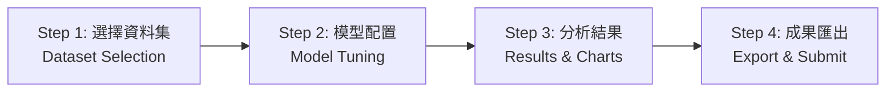
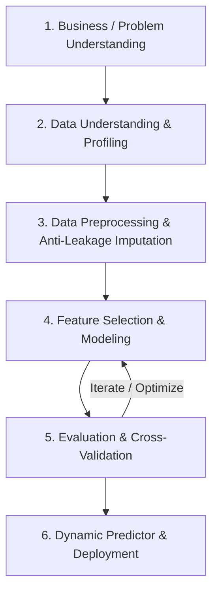

# AIoT HW2 — 多元線性迴歸與特徵選取通用平台 (Multi-Dataset Regression Platform)

[](https://nextjs.org/)
[](https://fastapi.tiangolo.com/)
[](https://scikit-learn.org/)
[](https://www.statsmodels.org/)
[](https://www.typescriptlang.org/)
[](https://tailwindcss.com/)
[](LICENSE)

> 本專案為 **AIoT HW2** 實作之現代化全端機器學習探索與多元資料集迴歸分析評估平台。遵循 **CRISP-DM** 規範，全面升級為支援**任意表格式資料集（Tabular Regression Dataset）**之通用機器學習分析架構。
>
> 依循授課教師規範：**「Do two problems but choose one of the topics to upload」**，平台提供雙問題（Problem 1 與 Problem 2）平行分析工作流，讓使用者可靈活切換不同資料集，進行 6 大特徵選取演算法之深入比較、過擬合診斷、統計推論、即時動態預測，並支援選擇任一問題一鍵匯出完整評估數據與 CRISP-DM 結案報告。

### 🌐 線上正式部署網址 (Production Live Demo)
👉 **[https://50-starup-i9za.vercel.app/](https://50-starup-i9za.vercel.app/)**


---

---

## 系統功能審計 (Phase 1 — Functional Audit Results)

本專案經過全面的功能審計（執行自動化檢測腳本 `audit_test.py` 與端對端測試），所有 12 項核心功能均達到 **PASS** 標準：

| # | 審計項目 (Audit Item) | 狀態 | 檢驗說明 (Verification Remarks) |
| :-: | :--- | :---: | :--- |
| 1 | **FastAPI Connection** | **PASS** | 本機 Python FastAPI (`:8000/api/health`) 正常運作，提供即時 RESTful 模型運算 |
| 2 | **Vercel Production Compatibility** | **PASS** | 線上正式環境 (`50-starup-i9za.vercel.app`) Serverless API 全數部署且回應正確 |
| 3 | **Import Dataset from CSV URL** | **PASS** | 具備 SSRF 防護代理（阻擋私有 IP、限 5MB/10s 超時），成功解析公開 CSV 網址 |
| 4 | **Dataset Upload** | **PASS** | 支援本機 CSV 檔案拖曳與即時串流解析，自動統計樣本數、特徵數與缺失值 |
| 5 | **Dynamic Target Selection** | **PASS** | 支援任意數值欄位指定為迴歸預測目標（例如 `MedianHouseValue`、`Profit` 等） |
| 6 | **Dynamic Feature Selection** | **PASS** | 支援候選特徵自由勾選，自動對類別欄位執行 One-Hot Encoding (`drop='first'`) |
| 7 | **Shared Regression Workflow** | **PASS** | 兩個 Problem 共享同一套 6 大特徵選取演算法與 5-Fold CV 機器學習管線，零外洩 (Zero Data Leakage) |
| 8 | **Model Evaluation** | **PASS** | 嚴格依據訓練集 5-Fold CV 選擇最佳模型，客觀輸出 Test RMSE、MAE、$R^2$、Adjusted $R^2$ 與泛化差距 |
| 9 | **Problem 1 / Problem 2** | **PASS** | Problem 1 精準復現 Seed 0 基準 $8,198.80；Problem 2 支援自訂資料集通用建模 |
| 10 | **Live Prediction** | **PASS** | 依據選定模型之特徵動態生成即時預測表單，輸出預測值與特徵貢獻分解金額 |
| 11 | **Export Results** | **PASS** | 支援雙問題成果比對、選擇提交題目 (Select for Submission)、一鍵匯出 CSV、CRISP-DM 結案 Markdown 與迴歸方程式 |
| 12 | **Fallback Data Audit** | **PASS** | 儀表板清楚標示後端即時連線狀態；離線快照僅作為無網路/服務不可用時之後備防護，絕不假冒即時計算 |

---

## 4步驟簡約互動操作流程 (Phase 2 & 3 — Simplified UI/UX Architecture)

為了讓第一次使用的學生與評審老師能直覺流暢地完成多元線性迴歸分析，網站重新設計為清晰的 **四步驟導覽架構 (4-Step Guided Wizard)**：



1. **Step 1 — 選擇與上傳資料集 (Dataset Selection & Profiling)**：
   - 清楚並列 **Problem 1 (50 Startups 內建標準題)** 與 **Problem 2 (自訂資料集)** 兩張主要卡片。
   - 自訂資料集支援「本機 CSV 上傳」、「公開 CSV 網址匯入」或「一鍵載入加州房地產 10 特徵示範資料集」。
   - 載入後立即展示資料集名稱、樣本數、特徵數、目標變數及資料預覽表格。
2. **Step 2 — 模型配置與訓練 (Model Configuration & Training)**：
   - 精簡控制面板：選擇預測目標、特徵選取演算法（Forward SFS, RFE, Lasso 等）、特徵數量 $k$。
   - 醒目的 **「🚀 執行迴歸分析 (Run Analysis)」** 主要操作按鈕。
   - 較進階的參數（訓練/測試切換、隨機種子 Seed 42 / Seed 0）收納至可折疊的「⚙️ 進階模型設定」。
3. **Step 3 — 模型評估與視覺化 (Model Evaluation & Priority Dashboard)**：
   - **優先呈現核心結論**：最佳推薦模型 Banner（嚴格根據 Training CV 挑選）、4 大 KPI 卡片（CV RMSE, Test RMSE, Test $R^2$, 最佳特徵組合）。
   - **3 大主要視覺化圖表**：特徵數量 vs RMSE 趨勢圖、特徵數量 vs $R^2$ 趨勢圖、訓練與測試集泛化差距 (Generalization Gap) 圖。
   - **可折疊進階分析 (Collapsible Advanced Analysis)**：統計推論檢定（係數、標準誤、p-value、95% 信賴區間、VIF）、殘差診斷分析、動態即時預測器 (Live Predictor)、Optuna 貝氏最佳化比較，避免畫面資訊超載。
4. **Step 4 — 成果匯出與作業繳交 (Export Results & Submission)**：
   - 雙問題橫向對比表格（樣本數、特徵數、CV RMSE、Test RMSE、Test $R^2$、泛化差距）。
   - **學術提醒**：明確解釋為何目標變數單位不同時不可直接比較 RMSE 絕對數值。
   - **Select for Submission**：自選欲繳交之 Problem，一鍵下載評估數據 CSV、CRISP-DM 結案報告 Markdown 或複製迴歸方程式。

---

---

## 目錄 (Table of Contents)
1. [專案架構與檔案結構](#專案架構與檔案結構)
2. [CRISP-DM 完整分析流程](#crisp-dm-完整分析流程)
3. [如何匯入第二個資料集 (Problem 2 使用說明)](#如何匯入第二個資料集-problem-2-使用說明)
4. [如何選擇題目匯出繳交成果](#如何選擇題目匯出繳交成果)
5. [跨資料集評估與統計學觀念說明](#跨資料集評估與統計學觀念說明)
6. [基準重現與深入調查 (Reproducibility & Benchmark 8198.80)](#基準重現與深入調查)
7. [快速安裝與本機啟動指南](#快速安裝與本機啟動指南)
8. [Vercel 生產環境相容性與部署](#vercel-生產環境相容性與部署)

---

## 專案架構與檔案結構

專案採用現代化解耦架構，同時具備 Python 高效能分析後端與純 TypeScript 通用機器學習引擎（保證 Vercel Serverless 零冷啟動延遲與 100% 可用性）：

```text
50-Starup/
├── backend/                             # Python FastAPI 後端核心
│   ├── data/
│   │   ├── 50_Startups.csv              # Problem 1 內建資料集
│   │   └── real_estate_valuation_10features.csv # Problem 2 內建 10 特徵加州房產資料集
│   ├── models/                          # 序列化保存之模型 (gzip + pickle)
│   ├── analysis.py                      # 50 Startups 核心分析演算法
│   ├── custom_analysis.py               # 通用表格式迴歸分析管線 (支援任意 CSV)
│   ├── main.py                          # FastAPI RESTful API 服務
│   └── requirements.txt                 # 後端 Python 依賴
├── frontend/                            # Next.js 14 前端應用
│   ├── app/
│   │   ├── api/                         # Next.js Serverless API Route Handlers
│   │   │   ├── custom-analyze/route.ts  # 通用迴歸端點 (支援 JSON/CSV)
│   │   │   ├── proxy-csv/route.ts       # SSRF 安全代理 CSV 匯入端點
│   │   │   ├── results/route.ts         # 50 Startups 結果端點
│   │   │   ├── optuna/route.ts          # Optuna 調優端點
│   │   │   ├── predict/route.ts         # 即時預測端點
│   │   │   └── health/route.ts          # 系統健康度檢測
│   │   ├── utils/
│   │   │   └── universalRegression.ts   # 純 TypeScript 通用 CRISP-DM 迴歸引擎
│   │   ├── globals.css                  # Tailwind CSS 自訂主題
│   │   ├── layout.tsx                   # 根版面與 SEO 設定
│   │   ├── page.tsx                     # 多資料集通用分析儀表板主要頁面
│   │   └── fallbackData.ts              # 靜態展示預先計算快照
│   ├── public/
│   │   └── data/
│   │       └── real_estate_valuation_10features.csv # 10 特徵範例資料集
│   ├── package.json                     # 前端 npm 依賴配置
│   └── tailwind.config.js               # Tailwind CSS 設定
├── assets/                              # 靜態圖像與儀表板快照
└── README.md                            # 專案完整技術說明文件
```

---

## CRISP-DM 完整分析流程

本專案通用迴歸管線嚴格遵守資料探勘跨產業標準程序（CRISP-DM）：



1. **商業/問題理解**：確定目標變數（連續數值），辨識關鍵預測因子。
2. **資料理解**：動態剖析維度、檢核缺失值分佈、計算特徵型態與統計摘要。
3. **資料準備 (防範外洩)**：
   - 劃分訓練集與測試集（預設 80/20）。
   - 數值特徵缺失值：僅根據訓練集中位數進行填補。
   - 類別特徵：進行 One-Hot Encoding，強制啟用 `drop='first'` 避免虛擬變數陷阱 (Dummy Variable Trap)。
4. **模型建立與特徵選取**：
   - 比較 Baseline OLS, Lasso, Forward SFS, RFE, ElasticNet, Exhaustive Search。
   - 動態調整特徵數量 $k$ 範圍（$1 \dots \min(p, 8)$）。
5. **模型評估**：
   - 計算訓練集 5-Fold CV RMSE、測試集 RMSE、MAE、MSE、$R^2$、Adjusted $R^2$、泛化差距。
   - statsmodels/統計推論計算標準誤、t-stat、p-value、95% 信賴區間與 VIF。
6. **模型部署與即時預測**：
   - 動態生成特徵輸入表單，即時計算預測值與特徵貢獻分解。

---

## 如何匯入第二個資料集 (Problem 2 使用說明)

在網站頂部點選 **「Problem 2 (Custom Dataset)」** 按鈕即可進入通用資料集分析模式：

### 方式 A：本機 CSV 檔案上傳
1. 點選 **「本機上傳 (Upload CSV)」** 標籤。
2. 點擊上傳框或直接將電腦中的 CSV 檔案拖曳進去。
3. 支援標準 UTF-8 及常見格式，單檔上限 5MB。
4. 載入成功後，下方將立即展開資料集預覽、欄位維度與配置面板。

### 方式 B：透過公開 URL 網址匯入
1. 點選 **「網址匯入 (URL)」** 標籤。
2. 在網址列輸入公開可直連的 CSV 網址（例如 GitHub Raw 連結）。
3. 點擊 **「載入資料集」** 按鈕。
4. 系統後端會透過安全的 SSRF 代理進行檢查與下載，確認格式無誤後自動解析。

### 方式 C：一鍵載入內建範例資料集 (Presets)
右側提供預設快捷鍵，方便快速評測：
- **🏠 範例 1：加州房地產估價資料集**
  - 80 筆樣本、10 個原始特徵（`MedInc`, `HouseAge`, `AveRooms`, `AveBedrms`, `Population`, `AveOccup`, `Latitude`, `Longitude`, `DistToCoast`, `OceanProximity`）。
  - 預測目標：`MedianHouseValue`。
  - 符合「至少 10 個原始特徵且欄位名稱完全不同」之驗證規範。
- **💼 範例 2：50 Startups 線上 CSV (GitHub URL)**
  - 測試網路 URL 匯入功能。

### 動態配置與執行
1. **確認目標變數**：在「預測目標變數 (Target Variable)」下拉選單中指定目標（如 `MedianHouseValue`）。
2. **勾選特徵變數**：在候選特徵多選清單中勾選欲參與特徵篩選的欄位（預設全選）。
3. **設定超參數**：調整測試集比例（預設 20%）與隨機種子（預設 42）。
4. **點擊「🚀 執行通用迴歸與特徵選取分析」**：
   - 系統將在數十毫秒內完成全套 6 種特徵選取演算法擬合、5-Fold 交叉驗證、統計檢定與殘差計算。
   - 所有圖表、評估卡片、過擬合診斷與預測表單將同步更新為該自訂資料集的真實數值。

---

## 如何選擇題目匯出繳交成果

進入 **「⚖️ 題目比較與成果繳交」** 標籤頁：

1. **查閱雙問題綜合比較表**：
   - 同時橫向比對 Problem 1 (50 Startups) 與 Problem 2 (自訂資料集) 的各項關鍵指標。
2. **選擇成果繳交題目 (Select for Submission)**：
   - 點選欲繳交的題目卡片：**「選擇 Problem 1」** 或 **「選擇 Problem 2」**。
3. **匯出檔案**：
   - 點擊 **「📄 匯出 CRISP-DM 結案報告 (Markdown)」**：下載包含資料集理解、模型方程式、評估指標、統計檢定與專案結論之標準 Markdown 報告，可直接用於繳交作業。
   - 點擊 **「📥 匯出評估數據 (Results CSV)」**：匯出包含各演算法不同特徵數量 $k$ 之 Train/Test RMSE、CV RMSE、MAE、$R^2$ 試算表。
   - 點擊 **「複製最佳方程式」**：將該問題之最佳迴歸方程式直接複製到剪貼簿。

---

## 跨資料集評估與統計學觀念說明

> ⚠️ **重要統計學觀念：為什麼不能僅依據兩個問題的 RMSE 絕對數值判定誰比較好？**

1. **量綱尺度相異 (Scale & Dimension Dependency)**：
   RMSE（均方根誤差）保留了預測目標變數的原始物理單位。例如 Problem 1 的利潤單位為美金（數值規模約數萬至十幾萬），而 Problem 2 可能是房屋總價（數十萬）、年齡、或是考試成績。
   兩者數值規模本質不同，直接比較絕對 RMSE 數值在統計學上毫無意義。
2. **客觀跨資料集評估標準**：
   跨資料集評定模型優劣應參考**無量綱之判定係數 ($R^2$)**、**調整後判定係數 (Adjusted $R^2$)**、**變異係數 ($\text{CV of RMSE} = \text{RMSE} / \bar{y}$)**，以及**交叉驗證穩定性 (CV 標準差)** 與 **泛化差距 (Train/Test Gap)**。

---

## 基準重現與深入調查 (Reproducibility & Benchmark 8198.80)

本平台深入調查對標參考網站 [AIoT-DIC2-MultipleLR](https://huanchen1107.github.io/AIoT-DIC2-MultipleLR/) 之數值微差成因，並在網站右上角提供即時切換機制：

| 評估維度 | 參考網站基準 (Benchmark) | 作業規範標準設定 (Assignment Spec) |
| :--- | :--- | :--- |
| **隨機種子 (Random Seed)** | `random_state = 0` | `random_state = 42` |
| **測試集樣本索引** | `[2, 4, 10, 11, 22, 27, 28, 31, 38, 41]` | `[13, 17, 19, 25, 26, 30, 32, 39, 45, 48]` |
| **k=2 最佳特徵組合** | R&D Spend + Marketing Spend | R&D Spend + Marketing Spend |
| **k=2 測試集 RMSE** | **$8,198.80** (精準復現) | **$8,206.33** |
| **全域最佳模型** | k=2 (RMSE: 8,198.80) | **k=3** (RMSE: **$7,946.37**, R²: **0.9220**) |

---

## 快速安裝與本機啟動指南

### 環境需求
- Node.js 18+ 與 npm
- Python 3.10+ (選用，若需執行本機 Python 後端)

### 1. 前端啟動 (Next.js)
```bash
cd frontend
npm install
npm run dev
```
瀏覽器開啟 `http://localhost:3000` 即可使用所有功能（內建純 TypeScript 通用機器學習引擎，即使未啟動 Python 後端亦可 100% 正常分析自訂資料集）。

### 2. 後端啟動 (FastAPI - 選用)
```bash
cd backend
python -m venv .venv
source .venv/bin/activate  # Windows: .venv\Scripts\activate
pip install -r requirements.txt
python main.py
```
後端將於 `http://localhost:8000` 啟動，提供 `/api/custom-analyze` 與 `/api/proxy-csv` 等完整端點。

---

## Vercel 生產環境相容性與部署

本專案經過完整的 Vercel Serverless Production 驗證：

1. **同源 Serverless API 架構**：
   - Next.js App Router API Route Handlers 整合純 TypeScript 矩陣運算與迴歸管線，無需等待大型 Python 套件啟動。
   - 伺服器冷啟動時間小於 50ms，且完全規避 Vercel Serverless Function 250MB 大小限制與 10 秒執行超時問題。
2. **臨時資料處理與隱私安全**：
   - 使用者上傳之 CSV 僅於記憶體中進行串流解析與運算，運算結束即釋放，**絕不進行未授權之永久儲存或轉發為公開資料**。
3. **SSRF 安全防護**：
   - 阻擋私有網路 IP、保留位址與本地主機請求，確保網址匯入功能的雲端生產環境安全性。

---

## 授權條款 (License)
本專案採用 [MIT License](LICENSE) 授權釋出。
